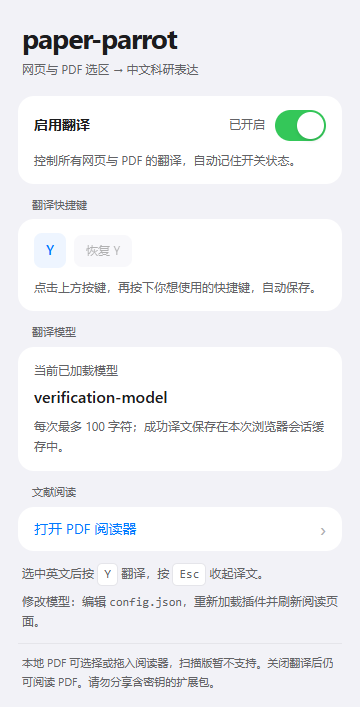
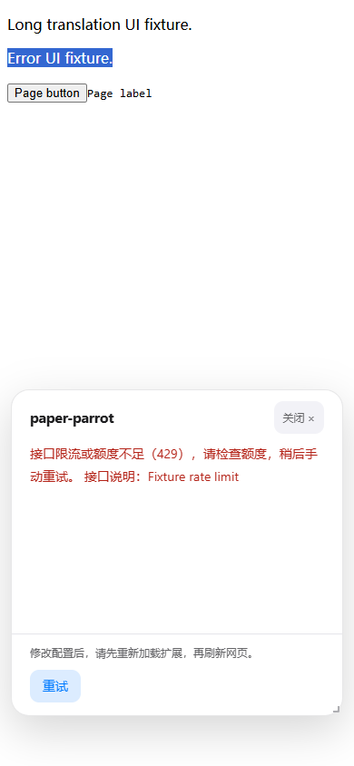

# paper-parrot · AI 产品设计与落地说明

更新日期：2026-10-13。本文说明产品决策如何落实为可体验的原型；作品集入口见 [README](README.md)，PDF 专项设计见 [PDF 阅读体验设计](PDF_SUPPORT_PLAN.md)。

## 1. 本案例呈现的产品设计工作

围绕“阅读英文文献时，局部内容需要中文辅助理解”这一任务，设计从场景、范围、交互、AI 行为和验证五个方面展开。

| 产品设计工作 | 本项目中的具体产出 |
| --- | --- |
| 场景定义 | 围绕网页与文字版 PDF 的精读任务，定义需要即时翻译的局部理解场景 |
| 范围取舍 | 优先完成选段翻译闭环；将 OCR、整篇处理、文献问答和导出放入后续方向 |
| 体验设计 | 网页与 PDF 共用快捷键和译文浮窗，提供全局开关、复制、退出与失败恢复 |
| AI 行为设计 | 限定科研翻译任务、输入范围、输出形式、长度边界和重复调用策略 |
| 验证设计 | 将交互可用性、模型翻译质量与阅读效果分开验证，不用模拟接口结果替代产品成效 |

现有材料没有正式用户访谈、规模化使用数据或真实模型质量评测。用户需求与价值判断应作为待验证假设阅读。

## 2. 设计原则与关键决策

### 让用户选择 AI 介入的时机

用户先阅读和选择，再按翻译快捷键调用模型（默认 Y，可在插件面板或 PDF 阅读页设置单键或组合键）。设置通过本地存储跨页面同步，重启浏览器后保留。空选区、输入框、编辑区域和输入法组合输入不触发翻译；只接受真实用户按键与真实重试点击。

这让“选择哪段、什么时候发送”成为清晰的操作。产品没有自动翻译整页，模型也不会收到选区之外的文献上下文。

### 保留原文，提供局部理解支持

译文出现在可关闭、可滚动的右下角浮窗，读者可以复制结果或收起后继续阅读。浮窗正文可选择，点击正文不会意外关闭；关闭后到达的结果不会重新打开浮窗。

当前浮窗没有原文并排展示或可调位置，可能遮挡正文。它是否比外部翻译工具更适合长时间精读，还需要观察真实阅读任务。

### 同一任务保持同一操作习惯

网页与插件 PDF 阅读页共用“选文字 → 按快捷键（默认 Y）→ 看译文 → 继续读”的流程。PDF 每次打开默认 100%，缩小时按可用宽度自动并排显示更多页面，放大时自动减少列数；“适应宽度”由用户手动选择。译文浮窗支持拖动标题栏移动、从四边或四角调整大小；缩放和重新排版时保留译文，换文件时清理旧结果。

插件面板与 PDF 阅读页的开关控制同一个全局翻译状态。读者在任一入口关闭后，其他已打开页面也停止翻译；PDF 的阅读操作继续可用。

### 为失败设计下一步

接口失败、超时、超长选区、复制失败和 PDF 加载失败都有中文反馈。可恢复的翻译错误支持重试原选区，用户无需重新拖选；不自动重试，避免在用户不知情时重复调用。

当前首次使用需要编辑配置、填入自己的 API 密钥并手动加载扩展，使用门槛仍高。面向更多读者前，配置引导与权限理解也需要验证。

## 3. AI 任务契约

| 项目 | 当前行为 | 对体验的影响 |
| --- | --- | --- |
| 输入 | 选区去掉首尾空白后的原文 | 发送范围可预期，但可能缺少前后文 |
| 任务 | 科研文献中英翻译，保留专业术语，使用中文科技表达 | 约束模型围绕阅读需求输出 |
| 输出 | 读取接口返回的中文译文，支持选择和复制 | 不增加聊天往返；没有自动核验或置信评分 |
| 长度 | 默认最多 5000 字符，前台与后台均检查 | 超长内容明确提示分段，不截断后偷偷发送 |
| 等待 | 当前非流式请求，总时限 25 秒 | 等待有上限；长段落和慢接口可能失败 |
| 调用控制 | 当前页面请求期间忽略重复触发；相同文本与配置的跨标签页并发请求合并 | 减少重复请求 |
| 截断结果 | 接口返回 `finish_reason: length` 时标记可能不完整，并不缓存 | 让读者知道结果需要进一步处理 |

固定任务指令：

> 你是科研文献专业中英翻译助手，只输出译文，不要多余说明。保留领域专业术语，译文通顺，符合中文科技论文表达习惯。

配置示例使用 `deepseek-flash`、`temperature: 0.3`，并关闭思考模式。这是当前原型的默认设置，尚无不同模型、参数或模式的质量与等待时间对比结论。

指令约束不能代替质量验证。当前没有领域术语库、全文上下文检索，也没有专门保证公式、引用编号和单位完整保留的规则。术语误译、否定关系、数字单位、缩写与指代是后续评估重点。

## 4. 交互状态与用户控制

| 状态 | 用户看到什么 | 可以做什么 | 行为边界 |
| --- | --- | --- | --- |
| 就绪 | 原网页或 PDF 阅读页 | 选择原文并按翻译快捷键（默认 Y） | 没有选区不发送请求 |
| 等待中 | “翻译请求中，请稍候...” | 收起浮窗，或关闭全局翻译 | 收起浮窗只隐藏界面；全局关闭中止本地等待 |
| 成功 | 译文、复制按钮；命中时显示“来自缓存” | 查看、选择、复制或关闭 | 缓存是复用结果，未进行质量复核 |
| 结果不完整 | 已有译文与不完整提示 | 缩短选区后再次翻译 | 该结果不进入缓存 |
| 可恢复失败 | 中文错误与处理建议，提供重试 | 重试原选区 | 不自动重发 |
| 需要修改配置或刷新 | 指明配置、权限或通信问题 | 按提示处理后再使用 | 不把所有错误都简化为“重试” |
| 全局关闭 | 开关显示已关闭，现有浮窗收起 | 阅读 PDF，或重新开启翻译 | 重新开启无需刷新；服务端可能继续处理已发出的请求 |

默认翻译开启。状态保存在本地存储中，重新加载扩展或重启浏览器后仍保留。开关读取或保存失败时给出提示；保存失败保留原状态，支持再次操作。

输入保护、键盘焦点、长译文滚动、窄窗口布局、开关的键盘操作和减少动画偏好已纳入现有交互验证。它们用于保障操作连续性，不构成完整无障碍认证。

| 控制面板：开关、模型与文献入口 | 失败恢复：处理建议与手动重试 |
| --- | --- |
|  |  |

*截图来自隔离浏览器中的界面预览，模型名、长度限制、原文与响应均为测试配置，不代表默认配置或真实模型输出。*

## 5. 数据、缓存与信任边界

### 用户主动发送什么

本地 PDF 在本机解析；翻译调用发送选中的原文，不上传整份文件。在线文献需先下载，再选择或拖入阅读器。所选文字交给 `config.json` 配置的远程模型服务，服务侧的数据处理取决于所用服务。

翻译配置与密钥由后台读取，不交给网页或控制面板；配置文件不向网页开放。界面与错误说明避免输出密钥，译文按纯文本展示。

密钥仍以明文保存在本地配置中，因此当前是个人本地体验原型。分享源码或扩展目录时不能携带真实密钥。

### 如何减少重复调用

成功且未被接口标记为截断的结果进入浏览器会话缓存。相同原文、接口、模型、temperature、thinking 模式和任务指令才复用结果；错误、空结果和明确不完整结果不缓存。

缓存跨网页、PDF 和标签页复用；后台休眠后仍可使用。重新加载或禁用扩展、重启浏览器后清空。它不会同步到账号，也没有历史浏览、收藏和导出入口。

默认最多 100 条，原文与译文累计上限 500000 字符，超过时淘汰最近最少使用的条目。缓存故障不影响已成功译文的展示。

### 停用与取消的区别

按 Esc、关闭浮窗或切换 PDF 只撤下当前结果展示，不保证停止已发送的模型调用。关闭全局翻译会中止本地等待、拒绝旧结果继续显示，但不能保证远程服务停止生成或计费。

## 6. 验证证据与结论边界

以下为仓库中保留的自动验证报告。所有报告都使用模拟接口，未调用真实模型。报告快照与测试界面截图已整理到 `docs/validation/` 和 `docs/images/`，供读者直接查看；新增验证应以复跑结果为准。

| 验证层次 | 现有记录 | 可以支持的结论 |
| --- | --- | --- |
| 后台模拟验证 | 161 项断言通过；[查看报告](docs/validation/background-report.json) | 配置、请求、缓存、错误与全局状态按预期处理 |
| Chromium 原生扩展 | 33 项通过；[查看报告](docs/validation/native-report.json) | 在隔离 Chromium 中验证真实 MV3 扩展行为 |
| Chromium 原生 PDF 扩展 | 65 项通过；[查看报告](docs/validation/pdf-report.json) | 默认 100%、自动多列、窗口重排、第二列翻译、导航、缩放保留译文与恢复流程可运行 |
| 界面交互 | 41 项通过；[查看报告](docs/validation/ui-report.json) | 浮窗移动与八方向缩放、窄窗口、自定义快捷键与持久化、错误恢复符合当前设计 |
| Edge 阅读页引擎 | 12 项通过；[查看报告](docs/validation/edge-reader-report.json) | 真实 Edge 引擎能运行默认 100%、自动多列、阅读页及模拟翻译界面 |

Chromium 验证报告中的浏览器版本为 151.0.7922.34；Edge 阅读页验证为 152.0.4191.53。Edge 验证通过本地 HTTP 页面与模拟 `chrome.runtime` 执行，不能替代 Edge 原生扩展安装验收。

正式 Chrome / Edge 扩展管理页手动安装、用户实际文献中的复杂排版、真实模型质量，以及阅读任务的效果仍待评估。

## 7. 下一轮产品验证与迭代

| 假设 | 计划的验证方式 | 后续决策 |
| --- | --- | --- |
| 选段翻译能减少阅读切换负担 | 对比同类文献任务的完成时间、工具切换次数与读者主观负担 | 保留或调整快捷键、浮窗与入口提示 |
| 当前译文足以帮助理解关键句段 | 选取不同领域、句型与排版的真实片段，人工核对术语、逻辑、数字和指代 | 决定领域术语、上下文与原文对照的优先级 |
| 等待与失败提示可以被正确理解 | 观察首次使用、慢响应、超时、停用与手动重试 | 调整状态文案，评估流式展示 |
| PDF 阅读页符合实际精读任务 | 观察本地文件的打开、双栏拖选、缩放与翻页，以及浮窗移动和大小调整 | 修正选区问题，再评估 OCR 的需求频率 |

上述指标尚未采集。不能据此宣称效率提升、准确率或用户满意度已达到某个数值。

优先完成真实文献与正式浏览器验收；随后根据观察处理影响理解与阅读连续性的问题。术语表、原文对照、流式展示、OCR 和导出均为后续方向。

---

## 附录 A / 本地体验与配置

扩展采用原生 JavaScript，无需安装运行依赖或执行构建命令。Chrome 与 Edge 共用源码；PDF 功能需要 125 或更新版本，网页部分按 manifest 声明以 102 为最低版本。

1. 下载或克隆源码。如果根目录没有 `config.json`，从 `config.example.json` 复制一份，再填写自己的密钥。
2. 在 `chrome://extensions` 或 `edge://extensions` 开启开发者模式，加载项目根目录。
3. 刷新普通 HTTP / HTTPS 网页，选中英文按翻译快捷键（默认 Y，可在插件面板修改）。PDF 从插件打开独立阅读页后使用相同操作。
4. 修改配置后，在扩展管理页重新加载扩展，并刷新网页或 PDF 阅读页。配置在当前会话内不热更新。

仅在文件不存在时复制：

```powershell
if (-not (Test-Path -LiteralPath config.json)) {
    Copy-Item -LiteralPath config.example.json -Destination config.json
}
```

配置示例来自项目的示例文件：

```json
{
  "model": "deepseek-flash",
  "baseUrl": "https://api.deepseek.com",
  "apiKey": "",
  "temperature": 0.3,
  "thinking": { "type": "disabled" },
  "maxTextLength": 5000,
  "cacheMaxEntries": 100
}
```

`baseUrl` 填接口根地址，后台去掉末尾斜杠并追加 `/chat/completions`。服务需兼容当前 Chat Completions 请求格式、Bearer 认证、temperature 和字符串译文响应；不支持 `thinking` 的服务需移除该字段。

配置缺失、无法解析、字段不合法、空密钥或占位配置不会发起模型请求。配置首次读取后作为当前浏览器会话的快照；后台休眠恢复继续使用，重新加载扩展或重启浏览器后重新读取。

普通顶层网页与本扩展的指定 PDF 阅读页可以触发翻译。浏览器内部页、扩展商店、iframe 和内置 PDF 阅读器不直接注入。Firefox 未适配。

## 附录 B / 实现与异常处理索引

| 文件或目录 | 支撑的产品行为 |
| --- | --- |
| `manifest.json` | 浏览器扩展入口、权限、后台与页面注册 |
| `background.js` | 模型调用、配置快照、缓存、请求取消、错误处理与全局状态 |
| `content.js` | 选区、输入保护、快捷键、译文浮窗、复制和重试 |
| `shortcut.js` | 快捷键录入、恢复默认、本地保存与跨页面同步 |
| `plugin-control.js` | 插件面板与阅读页的同一全局开关 |
| `popup.html` / `popup.js` | 开关、已加载模型与 PDF 入口 |
| `pdf-reader.html` / `pdf-reader.js` / `pdf-reader.css` | 文献打开、文字层、阅读导航、缩放与异常恢复 |
| `ui.css` | 共享界面样式 |
| `vendor/pdfjs/` | PDF.js 本地资源与许可证 |

模型请求由 Manifest V3 后台发出，接口地址、认证和参数由本地配置决定，网页只传原文。来源限定为顶层 HTTP / HTTPS 页面与本扩展指定阅读页，拒绝其他扩展与不支持的页面来源。

当前使用 HTTP / HTTPS 广泛主机权限，以便调用用户在本地配置的模型接口；插件不读取当前标签页地址，不申请浏览历史权限。面向更多用户分发前，应重新评估权限范围与授权流程。

| 异常 | 用户可执行的处理 |
| --- | --- |
| 配置缺失、解析失败或字段不合法 | 检查配置，重新加载扩展并刷新阅读页 |
| 401 / 403 | 检查密钥、模型权限与账号状态 |
| 404 | 检查接口根地址、路径与模型名称 |
| 429 | 检查额度或频率，稍后手动重试 |
| 400 等请求错误 | 检查模型与参数；接口说明经过长度限制和密钥脱敏 |
| 5xx | 等待服务恢复，再手动重试 |
| 网络失败或 25 秒超时 | 检查网络、接口与权限，缩短选区或重试 |
| 非 JSON、空译文或结构异常 | 检查接口对 Chat Completions 的兼容性 |
| 重新加载后通信失效 | 刷新当前页面，不自动重发 |

## 附录 C / 验证复跑

`.verification` 中的脚本使用独立临时扩展、合成文献和模拟配置，不需要真实密钥。报告、截图与下载缓存被 Git 忽略；脚本保留在仓库中。报告文件是本地验证产物，下载仓库后需要复跑生成。

后台验证只需 Node.js：

```powershell
node .verification/verify-background.cjs
```

浏览器验证需要 Playwright 及匹配的 Chromium；PDF 验证另需 pdf-lib、Python 与 pypdf。它们属于验证依赖，扩展使用者无需安装。模块路径参数需换成实际环境中的路径：

```powershell
node .verification/verify-native.cjs <playwright-module-path>
node .verification/verify-ui.cjs <playwright-module-path>
node .verification/verify-pdf.cjs <playwright-module-path> <pdf-lib-module-path>
node .verification/verify-edge-reader.cjs <playwright-module-path> <pdf-lib-module-path>
```

本地模拟交互预览：

```powershell
node .verification/preview-server.cjs
```

随后访问 `http://127.0.0.1:8765`。该预览模拟后台，不连接真实模型，不能替代原生扩展验证或模型质量评估。
