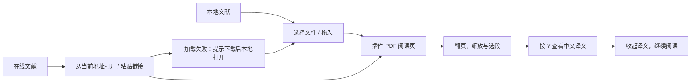

# paper-parrot · PDF 阅读体验设计

更新日期：2026-10-13。PDF 阅读与选段翻译已在 1.1.0 中实现；本文聚焦从文献打开到继续阅读的体验设计。作品集总览见 [README](README.md)，AI 行为与落地细节见[产品方案与落地说明](IMPLEMENTATION_PLAN.md)。

## 1. 从网页翻译延伸到文献阅读

网页选区翻译已经形成“选段 → 按 Y → 看译文”的基础体验。PDF 升级要解决的是：当阅读对象变成下载的论文或在线 PDF，读者仍能按同样的方式获得局部中文理解支持。

核心场景假设是：读者希望保留论文的页码、版式和阅读位置，按需理解部分句段，再继续阅读。当前未通过正式访谈或阅读实验验证这一需求的频率与强度。

**本次目标：打通文字版 PDF 的打开、阅读、选段翻译与失败恢复，延续网页已有的操作习惯。**

## 2. 方案取舍：为什么增加插件阅读页

| 方案 | 对读者的影响 | 本次取舍 |
| --- | --- | --- |
| 在浏览器内置 PDF 阅读器直接翻译 | 可以保留熟悉的阅读环境 | 当前扩展没有直接接入该阅读器；暂不作为本次交付路径 |
| 复制段落到外部翻译工具 | 无需新增阅读器，但阅读与翻译分散在不同页面 | 保留作为基线方案，用于后续阅读任务对比 |
| 在插件自己的 PDF 阅读页中翻译 | 打开文献后，可以复用选段、按 Y 和浮窗交互 | 当前选择；接受在线文献需要转入新阅读页的步骤 |

插件阅读页既承接文献，也让文字选区、翻译状态和阅读控制处于同一套体验中。它增加了打开文献的操作成本，因此后续验证需要观察读者是否能顺利找到入口，以及这一成本是否值得。

本次优先支持已有文字层的 PDF。扫描文件需要额外的文字识别和质量处理，OCR 未实现；整篇翻译、导出与批注编辑同样不在当前范围内。

## 3. 用户旅程：两个入口，一套翻译体验

### 本地文献：从手头文件开始

点击插件的“打开 PDF 阅读器”，选择文件或直接拖入。文献显示后，读者可以翻页、跳页、缩放或适应宽度，再选中英文段落按 Y。

本地文件由文件选择器读取，不要求额外开启“允许访问文件网址”。文件在本机解析，只有主动选中的原文作为翻译输入发送给模型。

### 在线文献：让入口跟随当前阅读对象

在当前 PDF 页面打开插件，点击“使用当前页面地址打开 PDF”，在新的插件阅读页中继续操作。也可在阅读页粘贴链接；是否为 PDF 依据实际内容解析，不要求链接以 `.pdf` 结尾。

当前在线加载不自动带入浏览器阅读器的登录凭据。需要登录、链接失效或服务端拒绝访问时，提供下载后本地打开的路径。首次加载等待超过 60 秒会给出提示，不自动重试。

### 阅读期间：保持操作一致和结果对应

网页与 PDF 共用 Y 翻译、Esc 收起、复制、等待反馈和手动重试。PDF 只将文字层选区作为原文，阅读页标题、链接输入框和已有译文不会被误当作待翻译内容。

切换文献或缩放时清理旧选区与浮窗，旧响应不会重新出现在新文献上。已经发送的请求可能仍在远程处理；清理界面不代表取消服务端生成或计费。

## 4. 信息架构与界面层级

| 界面区域 | 提供的信息或操作 | 服务的阅读任务 |
| --- | --- | --- |
| 顶部栏 | 产品名称、快捷键提示、全局翻译开关、本地文件入口 | 知道如何获得翻译，并随时控制是否启用 |
| 在线入口 | 链接输入与打开操作 | 从在线文献进入阅读 |
| 阅读工具栏 | 文件名、当前页 / 总页数、翻页、页码跳转、缩放、适应宽度 | 维持阅读位置，调整可读尺寸 |
| 状态栏 | 加载、文字层与异常提示；说明仅发送主动选择的文字 | 理解当前是否可翻译，以及数据发送范围 |
| 纸面区域 | 原文页面和可选择的文字层 | 阅读并选择需要理解的内容 |
| 译文浮窗 | 等待、结果、复制、关闭或重试 | 完成一次局部理解任务，再回到原文 |

默认适应宽度，缩放范围 25%–400%。页码输入会限制在有效范围，文档尚未打开时导航不可用。

浅色背景与纸面、圆角按钮和蓝色操作强调延续插件面板的视觉语言。阅读控制与翻译控制分别承担明确任务：关闭 AI 翻译后，文献打开、翻页和缩放仍可使用。

## 5. 异常体验：失败之后仍能继续

| 场景 | 用户反馈与下一步 | 设计目的 |
| --- | --- | --- |
| 尚未打开文献 | 空状态解释选择文件、拖入与粘贴链接 | 帮助首次使用者找到起点 |
| 当前页没有文字层 | 提示可能为扫描页、需要 OCR，当前不支持 | 解释为什么无法选段，不发送空请求 |
| 文字层加载失败 | 提示重新打开或尝试其他 PDF | 区分文件可显示与文字可选择的状态 |
| 文件损坏或链接返回网页 | 提示无法解析为 PDF，允许重新选择 | 避免失败后进入不可恢复的空白状态 |
| 密码保护文件 | 明确提示暂不支持 | 让读者了解当前能力范围 |
| 在线加载失败或等待过久 | 检查链接和网络，或下载后本地打开 | 提供替代路径 |
| AI 翻译接口失败 | 沿用中文处理建议；可恢复时重试原选区 | 保持与网页一致的恢复习惯 |
| 翻译期间切换文件 | 清理旧浮窗，晚到结果不显示到新文献 | 避免译文与原文对象错位 |
| 全局翻译关闭 | 所有译文收起，快捷键停用；阅读仍可继续 | 让 AI 停用不打断基础阅读任务 |

没有文字层的判断以当前页为单位，不将含扫描页的混合 PDF 全篇认定为不可翻译。多栏文字的提取顺序取决于 PDF 文件与文字层；合成样本通过不代表所有复杂版式都能正确选择。

## 6. AI 与数据边界

- PDF 在本机解析，翻译发送用户主动选中的文本，不上传整份文献。
- 选区翻译需要联网，所选文字由用户配置的远程模型服务处理。
- 没有全文上下文、OCR、领域术语库或自动质量核验，关键内容需结合原文判断。
- PDF 内嵌脚本、交互批注与表单未启用。
- 切换文献时释放旧渲染资源；从当前地址打开后移除阅读页地址中的初始链接参数，减少复制地址时带出签名信息的风险。
- 密钥只由后台使用，不展示在阅读页；本地配置仍须由使用者保管。

## 7. 已有验证与待完成验收

本节根据现有报告整理，本次文档改写未重跑功能测试。验证使用合成 PDF 与模拟接口，未调用真实模型。下表链接指向保留在 `docs/validation/` 中的报告快照。

| 证据 | 现有结果 | 对产品体验的支持 |
| --- | --- | --- |
| Chromium 原生 PDF 扩展 | 52 项通过；[查看报告](docs/validation/pdf-report.json) | 本地 / 在线打开、单栏 / 双栏 / 多页、选区、翻译、缓存、错误恢复和停用可运行 |
| Chromium 原生网页扩展 | 33 项通过；[查看报告](docs/validation/native-report.json) | PDF 升级后网页翻译和全局状态继续可用 |
| 后台模拟验证 | 161 项通过；[查看报告](docs/validation/background-report.json) | 阅读页来源、请求控制、缓存和取消逻辑符合预期 |
| Edge 阅读页引擎 | 10 项通过；[查看报告](docs/validation/edge-reader-report.json) | 真实 Edge 引擎中的阅读、模拟翻译、开关与键盘操作可运行 |

原生 PDF 验证运行于隔离 Chromium 151.0.7922.34；Edge 阅读页验证为 152.0.4191.53，通过 HTTP 页面与模拟扩展通信完成，不能当作 Edge 原生扩展安装验收。

待完成的产品验收：

- [ ] 在正式 Chrome / Edge 扩展管理页手动加载，确认首次进入流程。
- [ ] 使用实际论文检查双栏顺序、特殊字符、复杂公式与缩放后的选区。
- [ ] 使用真实模型人工核对术语、句间关系、否定和数字单位。
- [ ] 观察读者能否理解 PDF 入口、扫描页提示和在线加载失败后的替代路径。
- [ ] 对比外部翻译工具，评估阅读切换、任务完成时间与浮窗遮挡。

自动验证为流程正确性提供证据。阅读效率、理解可靠性和使用意愿仍需要真实任务评估。

## 8. 下一步设计重点

先处理实际文献中的选区与版式问题，完成真实翻译质量和首次使用验证。根据结果，再决定原文对照、术语规则、流式展示和 OCR 的优先级。

OCR、整篇翻译、术语表、导出与批注仍是后续方向，不能作为当前功能介绍。

---

## 附录 / 本地体验与实现索引

体验顺序：在扩展管理页加载或重新加载项目，点击插件打开 PDF 阅读器，选择文件或粘贴链接，选英文按 Y；按 Esc 收起。在线加载失败时下载后本地打开。

配置修改仍需重新加载扩展并刷新阅读页。PDF 功能需要 Chrome / Edge 125+；浏览器内置 PDF 阅读器无法直接使用本扩展的快捷键翻译。

| 实现资源 | 支撑的行为 |
| --- | --- |
| `pdf-reader.html` / `pdf-reader.css` | 文件与链接入口、导航、状态和纸面布局 |
| `pdf-reader.js` | PDF 加载、按需渲染、文字层状态、缩放翻页、资源清理和恢复 |
| `content.js` | 复用快捷键与译文浮窗，仅接受 PDF 文字层选区 |
| `background.js` | 校验阅读页来源，复用模型调用、缓存和请求控制 |
| `plugin-control.js` | 与插件面板同步的全局翻译开关 |
| `popup.html` / `popup.js` | 本地阅读入口与当前在线地址入口 |
| `vendor/pdfjs/` | 固定 PDF.js 6.4.299 legacy 资源、worker、字体、CMaps、WASM、ICC 与许可证 |

PDF.js 代码与运行资源随扩展提供，不从 CDN 加载执行代码。用户不需要启动服务器或安装 PDF 测试依赖。第三方来源见 [PDF.js 说明](vendor/pdfjs/README.md)。

验证脚本保留在 `.verification`；报告与截图属于被 Git 忽略的本地产物，下载仓库后需复跑生成。安装与复跑方法见[产品方案附录](IMPLEMENTATION_PLAN.md#附录-c--验证复跑)。
