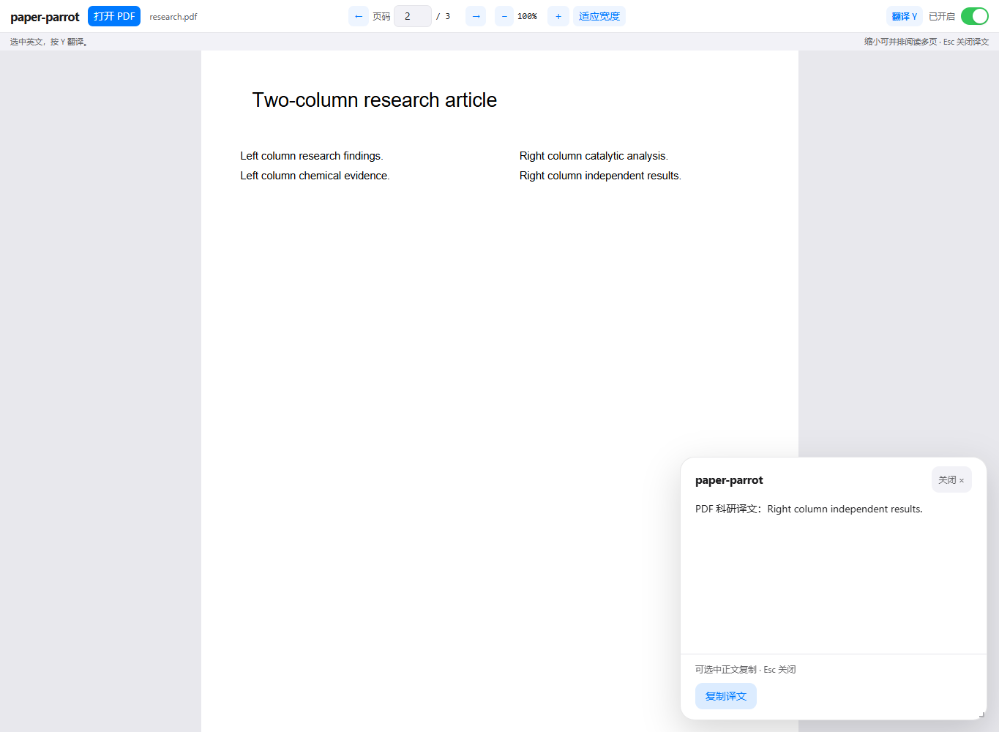
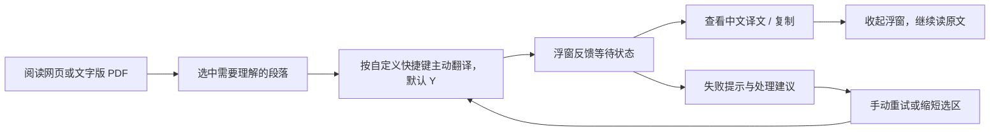

# paper-parrot · AI 文献阅读辅助产品

> 面向需要阅读英文科研文献的中文读者，把 AI 翻译放进阅读现场：选中难懂的段落，按 **Y**（默认，可自定义）查看中文译文，再继续读原文。

**项目方向：AI 产品设计 · 科研阅读场景 · 浏览器扩展**

**设计重点：阅读流程、按需交互、AI 输出约束、用户控制与异常恢复**

**当前阶段：已实现可本地体验的产品原型，支持网页与文字版 PDF；真实文献的翻译质量和阅读效果待系统评估。**

## 界面预览

*真实扩展界面的预览截图，使用合成文献与模拟模型响应，展示阅读和翻译交互；不是实际翻译质量样例。控制面板与失败恢复界面见[交互状态说明](IMPLEMENTATION_PLAN.md#4-交互状态与用户控制)。*

## 01 / 从什么阅读问题出发

本项目围绕一个具体场景展开：读者能阅读英文文献，但遇到专业术语、长句或关键论证时，需要中文帮助理解，随后还要回到原文继续判断。

如果每次都复制原文、切换翻译工具、粘贴，再回到文献，阅读任务就被拆成多次操作。paper-parrot的产品目标是**让理解支持出现在需要它的那一刻，减少离开阅读页面的操作**。

这是当前方案的场景假设，尚未通过正式用户访谈或阅读效率实验验证。

| 阅读场景 | 用户要完成的任务 | 产品回应 |
| --- | --- | --- |
| 浏览论文网页，遇到难懂的句段 | 理解当前选中的内容，再接着读 | 在原页面按需调出中文译文 |
| 阅读下载的文字版 PDF | 一边看原文排版，一边理解局部段落 | 在插件阅读页中选择文字并翻译 |
| 暂时只想阅读，或正在输入文字 | 控制 AI 何时介入 | 全局开关；输入区域不触发快捷键 |
| 等待过久、翻译失败或反复查看同一段 | 知道发生了什么，并继续完成任务 | 等待反馈、处理建议、手动重试和会话缓存 |

## 02 / 产品定位与范围取舍

**定位：服务英文科研文献精读的 AI 阅读辅助工具。** 核心任务是帮助读者跨过局部理解障碍，保留原文作为判断依据。

第一版把体验收敛为一条完整路径：**阅读原文 → 选择内容 → 主动翻译 → 查看或复制 → 继续阅读**。

| 设计选择 | 对用户的价值 | 接受的取舍 |
| --- | --- | --- |
| 由用户选择段落，主动按快捷键触发 | 翻译范围明确，调用时机由读者决定 | 模型只获得选区，可能缺少全文上下文 |
| 先提供局部翻译 | 围绕当前理解障碍完成一次任务 | 整篇翻译、摘要和文献问答留待后续验证 |
| 网页和 PDF 沿用同一交互 | 切换文献载体后可以复用操作习惯 | PDF 需要先进入插件自己的阅读页 |
| 使用可拖动、调整大小的浮窗展示结果 | 保留原文页面，译文可查看、选择和复制 | 初始在右下角，可拖动标题栏移动、拖动边缘或四角缩放；还需真实阅读测试 |
| 失败后由用户手动重试 | 让再次调用成为明确选择 | 用户需要判断何时重试 |

当前支持普通网页和带文字层的本地 PDF，文件可选择或拖入；在线文献需先下载。扫描 OCR、整篇翻译、文献问答、术语表、双语 PDF 导出和批注编辑均未实现。

## 03 / 核心体验：把 AI 放进阅读流程

**网页场景：** 在当前页面选中英文，按翻译快捷键（默认 Y）；中文译文初始显示在右下角，可拖动标题栏移动、拖动四边或四角调整大小，按 Esc 或点击关闭收起。输入框、编辑区域和输入法组合输入受到保护，正常输入不会触发翻译。

**PDF 场景：** 点击插件进入阅读页，选择或拖入本地文献，每次打开默认 100% 缩放。缩小到可容纳多页时自动并排成两列、三列，列数随页面大小和窗口宽度变化；放大后自动减少列数。顶部工具栏提供翻页、页码跳转、缩放、手动适应宽度和翻译设置；缩放或改变列数时保留译文浮窗，换文件时清理旧译文。

**快捷键设置：** 在插件面板或 PDF 阅读页点击当前快捷键，再按字母、数字、F1–F12 或组合键，即可自动保存；Esc 取消录入，插件面板可恢复默认 Y。设置跨网页和 PDF 阅读页同步，重启浏览器后保留。

**退出与恢复：** 插件面板和 PDF 阅读页共享“启用翻译”开关，状态在重启后保留。关闭后，所有已打开页面收起译文、停止快捷键翻译并中止本地等待；重新开启无需刷新，关闭期间仍可阅读 PDF。

## 04 / AI 产品设计：任务、输出与信任

AI 在当前产品中承担**科研文本的中英翻译**。选区是输入，中文译文是主要输出；界面承接等待、结果、复制和失败恢复。

当前实际使用的任务指令：

> 你是科研文献专业中英翻译助手，只输出译文，不要多余说明。保留领域专业术语，译文通顺，符合中文科技论文表达习惯。

| AI 设计点 | 当前方案 | 产品意图与边界 |
| --- | --- | --- |
| 任务约束 | 指定科研翻译、术语保留和中文科技表达 | 让输出围绕阅读任务；指令本身不能保证翻译准确 |
| 输入范围 | 仅发送用户主动选择的文字 | 让读者决定发送范围；缺失上下文可能影响术语和指代 |
| 输出形式 | 直接展示译文，支持复制 | 减少阅读时需要额外辨认的内容；当前没有质量评分或自动事实校验 |
| 默认模型参数 | 配置示例为 `deepseek-flash`，`temperature: 0.3`，关闭思考模式 | 为直接翻译提供可调整的起点；效果与等待时间尚未实测对比 |
| 重复调用 | 同一原文与配置复用会话缓存，并标记“来自缓存” | 减少已完成内容的重复请求；缓存命中不代表质量经过核验 |
| 不完整结果 | 接口报告输出达到长度上限时提示“译文可能不完整”，不缓存 | 让读者知道结果有边界，并可以缩短选区重试 |

PDF 在本机解析，整份文件不会作为翻译输入上传。主动选中的文字会发送到用户配置的远程模型服务，翻译需要联网。当前没有全文检索、术语知识库或自动核验机制，关键术语、公式和论证仍需结合原文判断。

## 05 / 交互设计：让状态可理解，让操作可控制

界面采用浅色阅读背景、圆角卡片和蓝色操作强调。插件面板依次呈现翻译开关、已加载模型和 PDF 入口；阅读页把文件操作、导航和纸面内容分开；译文浮窗保留可滚动正文、关闭与复制操作。

视觉层级服务于“读原文、按需看译文”的任务。真正影响体验的是每个状态是否有反馈，以及用户能否退出、恢复和继续阅读。

| 状态或行为 | 当前体验 | 设计考虑 |
| --- | --- | --- |
| 等待翻译 | 显示请求中状态；连续按键不会重复发送当前页面的请求 | 给出反馈，同时减少误触造成的重复调用 |
| 原文超过默认 5000 字符 | 显示长度与上限，提示分段选择，不发送请求 | 保留用户对输入范围的知情权，不静默截断 |
| 25 秒等待超时或接口失败 | 中文提示与处理建议；可恢复的错误提供手动重试 | 让失败之后仍有下一步操作 |
| 关闭浮窗或按 Esc | 隐藏结果；晚到的响应不会重新弹出 | 尊重读者已经退出的操作意图 |
| 关闭全局翻译开关 | 收起所有译文、停止触发、中止本地等待 | 让读者能整体停用 AI；不能保证服务端停止生成或计费 |
| 复制失败 | 保留译文，提示手动选择复制 | 保存已获得的结果，提供替代操作 |
| PDF 缩放 | 清理失效的原文选区，保留译文及等待中的请求 | 调整原文大小时仍可对照译文 |
| PDF 切换文件 | 清理旧选区与浮窗，旧结果不混入新文献 | 避免内容与阅读对象错位 |

## 06 / 产品验证：已有证据与待验证假设

现有自动验证使用合成文献、模拟密钥和模拟模型接口，覆盖真实浏览器中的选区、按键、浮窗、开关同步、PDF 阅读、异常恢复与缓存。它们为**交互是否按设计运行**提供证据。

这些验证尚不能证明真实模型的翻译准确率、阅读效率提升或用户满意度。正式 Chrome / Edge 的手动安装验收及用户真实文献评估仍待完成，具体记录见[产品方案与落地说明](IMPLEMENTATION_PLAN.md)。

下一轮产品验证围绕三类问题开展，当前均为计划：

| 要验证的问题 | 观察方式 | 对设计的影响 |
| --- | --- | --- |
| 是否减少阅读过程中的切换负担？ | 对比“复制到外部工具”和“选段按快捷键”的同类任务，记录完成时间、切换次数与返回原文的难度 | 判断快捷键和浮窗是否真正适合精读 |
| AI 译文是否支持可靠理解？ | 用真实文献样本检查术语、否定、数字单位、指代和长句关系，并与原文对照 | 决定是否优先加入术语规则或上下文输入 |
| 读者是否能掌控 AI 的介入？ | 观察首次使用、等待、关闭、停用、失败恢复及窄窗口阅读 | 调整入口提示、浮窗位置和状态表达 |

## 07 / 迭代方向

先完成真实文献和正式浏览器验收，再根据证据推进：

1. **理解可靠性：** 原文对照、术语规则和上下文输入，优先处理影响理解的误译。
2. **等待体验：** 评估流式展示，观察长段落的首次反馈和整体等待。
3. **文献覆盖：** 若扫描文献是高频需求，再引入 OCR；整篇处理和导出另行定义任务范围。
4. **首次使用：** 当前需要手动配置密钥和加载扩展，面向更多读者前还需验证配置引导与权限说明。

以上均为后续方向，未包含在当前原型中。

## 继续了解

- [产品方案与落地说明](IMPLEMENTATION_PLAN.md)：设计原则、AI 行为、交互状态、验证证据，以及安装与技术附录。
- [PDF 阅读体验设计](PDF_SUPPORT_PLAN.md)：文献入口、阅读旅程、方案取舍、异常恢复与验收。
- [PDF.js 来源与许可证](vendor/pdfjs/README.md)：第三方资源说明。

本地体验：安装与配置

1. 下载或克隆本仓库，将 `config.example.json` 复制为项目根目录的 `config.json`，填写自己的 `apiKey`，按需调整模型和接口根地址。
2. 打开 `chrome://extensions` 或 `edge://extensions`，开启开发者模式，点击“加载已解压的扩展”，选择项目根目录。
3. 刷新普通网页，选中英文按翻译快捷键（默认 Y，可在插件面板修改）；阅读 PDF 时先从插件打开自己的 PDF 阅读页。PDF 功能需要 Chrome / Edge 125+。
4. 修改配置后，重新加载扩展并刷新阅读页面。`baseUrl` 填根地址，后台追加 `/chat/completions`；不支持 `thinking` 参数的服务需移除该字段。

扩展使用原生 JavaScript，无需构建，PDF.js 资源已包含。扫描版、密码保护 PDF 和浏览器内置 PDF 阅读器直接翻译暂不支持；在线文献请下载后本地打开。

API 密钥明文保存在本地 `config.json`，该文件已被 Git 忽略。请勿分享含真实密钥的项目或扩展包。详细配置与复跑验证见[落地说明附录](IMPLEMENTATION_PLAN.md#附录-a--本地体验与配置)。

